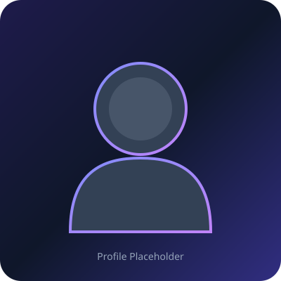

# Hassan Abdulganiu Oladimeji — Personal Portfolio Website

A modern, responsive, and high-performance personal developer portfolio built from scratch using **semantic HTML5**, **CSS3 (Variables, Flexbox, Grid)**, and **Vanilla JavaScript (ES6+)**.

---

## 🌟 Overview & Highlights

- **Aesthetic**: Premium dark developer theme (Midnight navy background, card surfaces, electric indigo & violet accents, and frosted glass navbar).
- **Zero Heavy Frameworks**: Pure vanilla web standards. No React, Next.js, Bootstrap, or Tailwind CSS — keeping code lightning fast, lightweight, and easy to understand.
- **100% Responsive**: Tailored fluid layouts for desktop monitors, tablets, and mobile smartphones.
- **Accessible (a11y)**: Semantic HTML tags (`<header>`, `<nav>`, `<main>`, `<section>`, `<article>`, `<footer>`) with explicit ARIA attributes and labels.
- **Client-Side Interactivity**:
  - Smooth scrolling navigation.
  - Mobile hamburger drawer with animated morphing icon.
  - Active section scroll tracking using modern `IntersectionObserver`.
  - Comprehensive client-side contact form validation with real-time error clearance.
- **Scalable Placeholders**: Includes crisp vector (`.svg`) placeholders for profile pictures and project cards so there are no broken links while you prepare your assets.

---

## 📂 Project Structure

```text
my-portfolio/
│
├── index.html                   # Core semantic HTML document with all 7 sections
│
├── css/
│   └── style.css                # Design system tokens, layout grids, animations & media queries
│
├── js/
│   └── script.js                # DOM event handlers, scroll spy, and form validation logic
│
├── images/
│   ├── profile-placeholder.svg  # Default avatar placeholder (replace with profile.jpg)
│   └── projects/                # Project preview card thumbnails
│       ├── project-1.svg
│       ├── project-2.svg
│       └── project-3.svg
│
└── README.md                    # Project documentation & customization guide
```

---

## 🚀 How to Run the Website Locally

You don't need any complex build tools or local servers to view your website!

### Option 1: Direct File Opening (Simplest)
1. Open File Explorer and navigate to:
   `c:\Users\USER\Desktop\AntiGravity\my-portfolio\`
2. Double-click **`index.html`** (or right-click -> **Open with** -> **Google Chrome**).
3. The portfolio will launch immediately in your web browser.

### Option 2: Using VS Code "Live Server" (Recommended for development)
1. Open the `my-portfolio` folder in **Visual Studio Code**.
2. Install the **Live Server** extension (by Ritwick Dey).
3. Right-click `index.html` and click **"Open with Live Server"**.
4. The page will reload automatically whenever you save changes to your code.

---

## 🛠️ Step-by-Step Customization Guide

### 1. Adding Your Real Profile Photo
1. Save your photo into `my-portfolio/images/` as **`profile.jpg`**.
2. Open [`index.html`](index.html) and locate the Hero section (around line 115).
3. Change:
   ```html
   
   ```
   To:
   ```html
   
   ```

### 2. Connecting Your Downloadable CV
1. Create a folder named `assets` inside `my-portfolio/`.
2. Place your resume PDF in it (e.g. `my-portfolio/assets/Hassan-Oladimeji-Resume.pdf`).
3. In [`index.html`](index.html), find the `Download CV` button in the Hero section and update its attributes:
   ```html
   <a href="assets/Hassan-Oladimeji-Resume.pdf" class="btn btn-secondary" download="Hassan-Oladimeji-Resume.pdf">
   ```

### 3. Adding Your Real Projects
In [`index.html`](index.html), find the `<section class="section projects-section" id="projects">`.
For each project card:
- Replace the placeholder image (`images/projects/project-1.svg`) with your screenshot.
- Update the `<h3 class="project-title">` with your project's name.
- Update the description and tech tags.
- Replace `href="#"` with your actual **Live Demo** URL and **GitHub Repository** URL.

### 4. Updating Education & Social Links
- **Education Section**: Search for `[Your University / Institution Name]` in `index.html` and replace it with your university.
- **Social Links**: Replace `[your-username]` and `[your-profile]` in the header, hero, contact section, and footer with your real GitHub and LinkedIn handles.

### 5. Connecting the Contact Form to Live Emails
Currently, the form runs robust client-side validation in JavaScript. When you are ready to receive real emails directly to `abdulganiuhassan6@gmail.com`:
1. Sign up for a free endpoint at [Formspree](https://formspree.io) or [Web3Forms](https://web3forms.com).
2. Add the `action` attribute to the `<form>` tag in `index.html`:
   ```html
   <form id="contactForm" action="https://formspree.io/f/YOUR_ENDPOINT_ID" method="POST">
   ```

---

## 🌐 How to Deploy for Free (GitHub Pages)

When you are ready to put your portfolio on the public internet:
1. Create a free account on [GitHub.com](https://github.com).
2. Create a new repository named `my-portfolio` (or `<your-username>.github.io`).
3. Upload all files from your `my-portfolio` folder to that repository.
4. Go to **Settings** -> **Pages** -> under **Branch**, select `main` (or `master`) and click **Save**.
5. Within 1 minute, your portfolio will be live worldwide at:
   `https://<your-username>.github.io/my-portfolio/`

---

## 📜 License & Attribution

Designed and developed by **Hassan Abdulganiu Oladimeji**. Built with clean code principles for longevity, maintainability, and accessibility.
